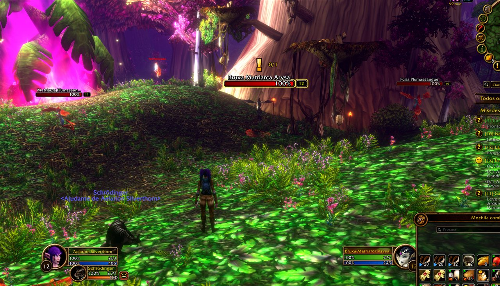
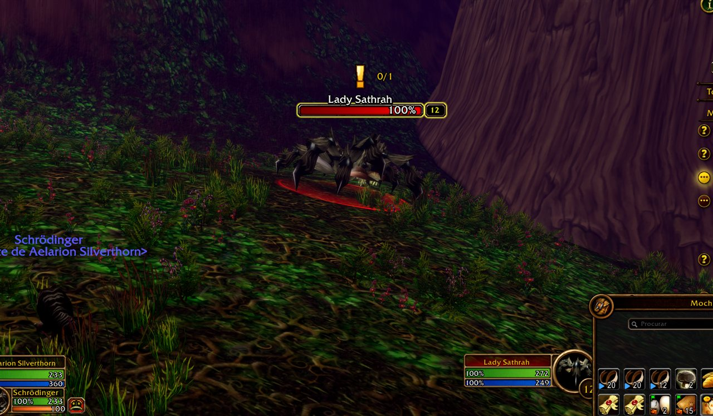
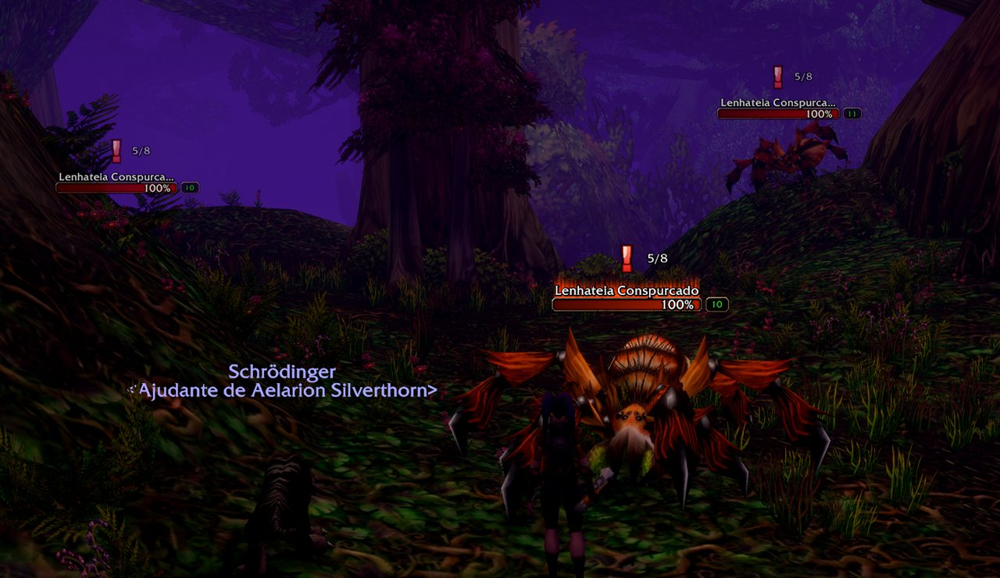

# CS.Coder - Quest Indicator

A floating, animated **"!"** over the mobs and items you still need for your quests. No more hovering every mob to find out which one drops your quest item.

| | |
|---|---|
|  |  |

## Features

- **Its own options window**, in a clean dark-and-gold look: switches, sliders with typed values, menus and a live preview. Open it with /cqi or the minimap button.
- **Setup guide:** new characters get a short guide: start with the defaults, or pick your icon, size, position and what to show, with a live preview.
- **Quest mobs:** a "!" floats above the nameplate of every mob you still need for an active quest. It disappears once the objective is done.
- **Quest items:** herbs, crates, sprouts and other quest items on the ground get a "!" too, on the nearest one in front of you.
- **37 icons in 3 categories:** Standard (quests), Themed and States / Priority, picked from a window that shows each category.

  
- **Quest progress:** the objective count ("8/12") next to each quest mob, glued to the icon or placed on its own, with its own size, font, outline and color. It can show on quest items too, pulses when it goes up and turns gold when one is left.
- **Check mark when done:** mobs you no longer need show a green check mark before their icon goes.
- **Ready to turn in:** a chat line when every objective of a quest is done.
- **Sound when an objective completes**, with a choice of sounds (hear each one in the menu) and its own volume.
- **Level alert:** the icon turns red for quests above your level — light red at 2 levels above, red at 3, full red at 4 or more.
- **Color by quest type:** daily and repeatable quests in blue, group and elite quests in red.
- **Hide during the fight** (optional): a mob fighting you loses its icon, and gets it back if it survives.
- **Gameplay tab:**
  - **Quest pickup** (optional): accepts the quests NPCs offer — automatically when you talk to them, or with an **Accept all** button on the NPC's list (a single quest is accepted at once). Dailies and repeatables can be left out.
  - **Auto turn-in** (optional): hands in finished quests. When you must choose a reward, you pick it.
  - Hold **Shift** when you click an NPC to do everything by hand that time.
  - Never gets in the way of another addon that already does this (Questie, Leatrix Plus, QuickQuest, AutoTurnIn).
- **Questie as a helper:** when Questie is active, its data fills in the count for quest drops the game doesn't show. Without it nothing changes.
- **Float and glow:** adjustable float height and duration, optional glow with adjustable intensity.
- **Size and position:** size, anchor (top, bottom, left or right of the nameplate) and X/Y for mobs and items; type exact values or use the sliders.
- **Own look for quest items:** their own icon, float and glow, if you like.
- **In combat:** keep, fade or hide the icons.
- **Not in dungeons and raids:** WoW Forever locks nameplates and quest information inside instances for every addon (Questie hides its icons there too). The icons come back as soon as you leave.
- **Quick themes:** Classic, Subtle or Flashy in one click.
- **Live preview** in its own small window, sized like your real nameplates.
- **Profiles:** create, copy, reset and delete; each character remembers its profile. Export a profile as text and import it on another PC or from a friend.
- **Help on hover** for the options, and a short "what's new" after each update.
- **Minimap button:** hover for a summary of what is left of each quest; left-click opens the options, right-click turns the addon on or off, drag to move.
- **Languages:** English, Português (Brasil), Español, Deutsch, Français, Italiano. Other game languages use English.

## How to use

1. Turn on enemy nameplates (default key **V**).
2. Open the options at **Options > AddOns > CS.Coder > Quest Indicator**, click the minimap button, or type **/cqi**.

| Command | What it does |
|---|---|
| `/cqi` | Opens the options |
| `/cqi toggle` | Turns the addon on or off |
| `/cqi setup` | Opens the setup guide again |
| `/cqi news` | Shows what's new in this version |
| `/cqi debug` | A short report to copy into a bug report |
| `/cqi plate` | Measures your target's nameplate so the preview matches it |

## Notes

- Quest items use the game's interact soft target, so only one item (the nearest in front of you) shows the icon at a time.
- Game settings can't be changed in combat, so a quest item you face mid-fight may only show its icon after combat.
- Works alongside ForeverLootSparkles.

## Install

Copy the `CSCoder_QuestIndicator` folder into `World of Warcraft\<version>\Interface\AddOns\`, or install it from CurseForge.

## Releasing (maintainers)

Push a version tag (for example `v1.2.5`). The GitHub Action packages the addon and uploads it to CurseForge (WoW Forever) and GitHub Releases. Plain commits publish nothing.

## License

MIT, see [LICENSE](LICENSE).
