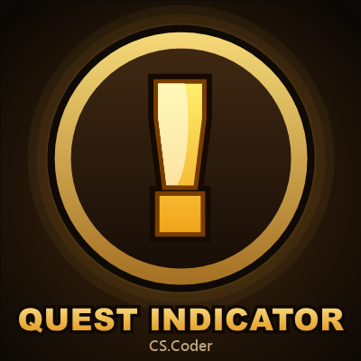

# CS.Coder - Quest Indicator

A floating, animated **"!"** over the mobs and objects you still need for your quests. No more hovering every mob to find out which one drops your quest item.

## Features

- **Quest mobs:** a "!" floats above the nameplate of every mob you still need for an active quest. It disappears once the objective is done.
- **Quest objects:** herbs, crates, sprouts and other quest items on the ground get a "!" too. It shows on the nearest one in front of you.
- **5 icon styles:** Gold, Blue, Red, Badge and Pixel.

  
- **Animation:** gentle up-and-down float with adjustable height and speed, or turn it off.
- **Glow:** optional spinning glow behind the icon, with adjustable intensity.
- **Size and position:** separate size and height for mobs and objects, plus horizontal position for mobs.

## How to use

1. Turn on enemy nameplates (default key **V**).
2. Open the options at **Options > AddOns > CS.Coder - Quest Indicator**, or type **/cqi**.

| Command | What it does |
|---|---|
| `/cqi` | Opens the options |
| `/cqi toggle` | Turns the mob icons on or off |

## Notes

- Quest objects use the game's interact soft target, so only one object (the nearest in front of you) shows the icon at a time.
- Game settings can't be changed in combat, so a quest object you face mid-fight may only show its icon after combat.
- Works alongside ForeverLootSparkles.

## Install

Copy the `CSCoder_QuestIndicator` folder into `World of Warcraft\<version>\Interface\AddOns\`, or install it from CurseForge.

## License

MIT, see [LICENSE](LICENSE).
