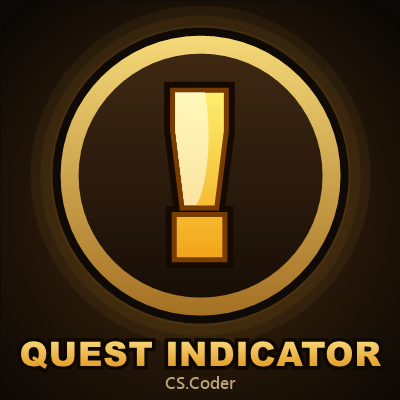

# CurseForge page (copy from here; this folder is not packaged)

## Summary (one line, under 100 characters)

A floating "!" over every quest mob and item you still need, with live progress (8/12).

## Description (Markdown)

**Never hunt the wrong mob again.** A floating, animated **"!"** marks every mob you still need for an active quest, and the quest item lying nearest to you, with your progress (**8/12**) right beside it. When an objective is done, the icon turns into a green check mark and goes.

### Highlights

- **Quest mobs and quest items** marked on their nameplates, with the objective count next to the icon.
- **37+ icons** in three categories (Standard, Themed, States), picked from a visual icon window.
- **A setup guide** on first login: start with the defaults, or choose your icon, size and position with a live preview.
- **Its own options window**, clean dark and gold: switches, sliders with typed values, menus and a live preview that matches your real nameplates.
- **Check mark when done**, a count that pulses when it goes up and turns gold when one is left, and a **"ready to turn in"** line in chat.
- **Quest summary** on the minimap button: hover it to see what is left of each quest.
- **Sound when an objective completes**: pick from several sounds, hear each one first, set its volume.
- **Anchor and position**: top, bottom, left or right of the nameplate, then fine-tune X and Y.
- **Quest items can have their own look** (icon, float, glow).
- **Quick themes**: Classic, Subtle or Flashy in one click.
- **Color by quest type**: daily quests in blue, group quests in red.
- **Hidden in instanced content** (dungeons and raids) by default; keep, fade or hide icons in combat.
- **Profiles** per character, with export and import to share them.
- **6 languages**: English, Portuguese (Brazil), Spanish, German, French, Italian.

### How to use

1. Turn on enemy nameplates (default key **V**).
2. Follow the setup guide, or open the options any time with **/cqi** or the minimap button.

| Command | What it does |
|---|---|
| `/cqi` | Opens the options |
| `/cqi toggle` | Turns the addon on or off |
| `/cqi setup` | Opens the setup guide again |
| `/cqi news` | Shows what's new in this version |
| `/cqi debug` | A short report to copy into a bug report |

### Notes

- Made for **WoW Forever**.
- Quest items use the game's interact soft target, so the nearest item in front of you shows the icon.
- Works alongside ForeverLootSparkles.

Found a bug or have an idea? Leave a comment or open an issue on [GitHub](https://github.com/cscoder69/CSCoder_QuestIndicator/issues).
